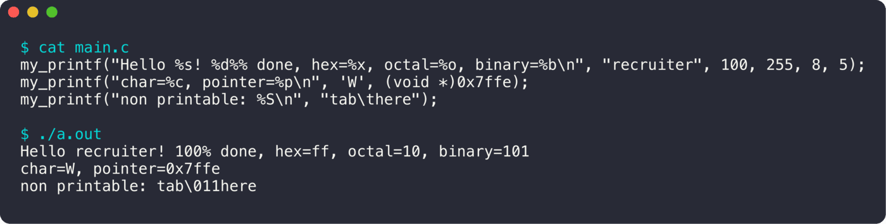

<div align="center">

# my_printf

**printf, réécrit à la main.**

  

<sub>Projet à 2 · 2022</sub>

</div>

<br/>

<p align="center"></p>

## Le projet en quelques mots

Une réimplémentation de `printf` en C, sans utiliser la libc à part `write` et `malloc`, compilée en bibliothèque statique `libmy.a`.

## Ce que ça fait

- Spécificateurs `%d %i %u %c %s %p %o %x %X %b %f %a %A %n %%`
- `%S` : affiche les caractères non imprimables en octal
- Flag `+`
- Une fonction par spécificateur, choisie dans une table de pointeurs sur fonctions
- Tests unitaires Criterion

## Lancer le projet

```bash
make
gcc main.c -L. -lmy
```

## L'équipe

<a href="https://github.com/Wilson-Epitech/my_printf/graphs/contributors"></a>

Wilson Bordichon, Yanis Harkouk

**Ma partition :** J'ai fait le **moteur principal** et la gestion des flags, le spécificateur `%S`, et la plupart des **tests unitaires**.
